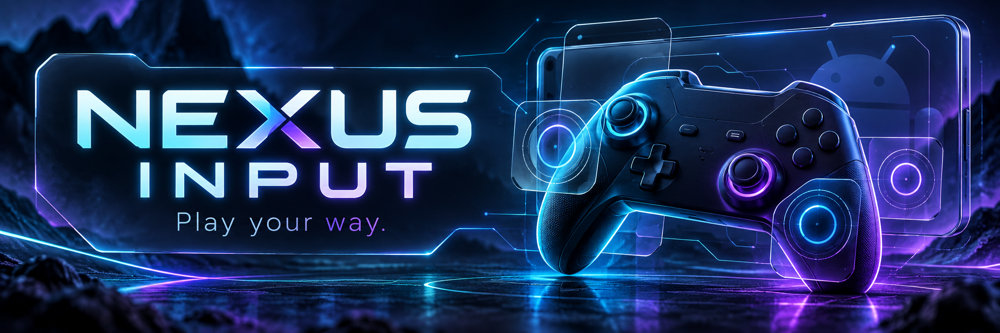

# Nexus Input

Your controller. Your game. Your layout.

Nexus Input lets you turn your gamepad buttons and sticks into touch controls for Android games. Pick a game, place your controls over a screenshot, and adjust the layout while you play. Each game keeps its own profile, so you can get things feeling right without starting over every time.

The new look is dark glass, cyan light and violet glow. There’s one bottom navigation bar, a cleaner mapping workspace, and small scrollable windows for long reports. Your game stays the focus.

[Download Nexus Input](https://github.com/esooLsIeicuJehT/nexus_input/releases/tag/v1.1.1-dev) · [Start here](#before-you-start) · [See the changes](CHANGELOG.md) · [Phone testing guide](docs/DEVICE_TEST_NEON_UPGRADE.md)

## Downloads

**The controller update is a development candidate.** Automated checks cannot confirm touches inside your game. The current Moto testing and follow-up findings are recorded in [the Stadia notes](docs/STADIA_FOLLOWUP_2026-10-11.md).

| Download | What it’s for |
| --- | --- |
| [Nexus Input-debug.apk](https://github.com/esooLsIeicuJehT/nexus_input/releases/download/v1.1.1-dev/Nexus.Input-debug.apk) | An installable debug build for testing the new UI and mapping fixes. |
| [Nexus Input.apk](https://github.com/esooLsIeicuJehT/nexus_input/releases/download/v1.1.1-dev/Nexus.Input.apk) | The installable release build, signed with the same development key as the debug download. |
| [KernelSU companion ZIP](https://github.com/esooLsIeicuJehT/nexus_input/releases/download/v1.1.1-dev/NEXUS_INPUT-KernelSU-Companion-v1.1.1-dev.zip) | The module for rooted KernelSU setups, including the matching WebUI and GitHub updater. |

Already have Nexus installed? Keep your profiles. Export them using **System → System tools → Local profiles & backup → Backup ZIP** before trying a test build. When the share menu opens, save the ZIP somewhere outside Nexus and confirm you can find it.

An APK update needs the same signing key as your installed copy. Older GitHub Actions debug APKs used temporary keys, so these downloads may not update them directly. If Android reports a signature mismatch, keep the installed app until your profile backup is safely exported and you have a restore path.

Both release-page APKs share one development signing key; the release build is not debuggable. These are installable development builds, not APKs signed with a recovered older GitHub key. Use the release-page downloads together rather than mixing APKs from separate Actions runs.

## Before you start

You'll need an Android phone, a game with touch controls, and a controller Android recognizes over Bluetooth or USB. **Android 14 or newer is needed for controller sticks to work while another game is open.** Older supported Android versions can still test inputs inside Nexus and capture keys, but have limited global input support.

There are two main ways to set up full gamepad mapping:

| Your phone | Use this setup | What to download |
| --- | --- | --- |
| Already rooted with KernelSU, such as the rooted Moto G 2026 | [KernelSU setup](#rooted-phone-kernelsu-setup) | Nexus APK and the companion ZIP for the root control center |
| Non-root, such as the Moto G 4G 2025 | [Shizuku setup](#non-root-phone-shizuku-setup) | Nexus APK and Shizuku |

The **APK** is the mapper: it stores profiles, reads controller input, places touch targets and runs the floating editor. The **KernelSU ZIP** adds the rooted companion's WebUI for device diagnostics, supported performance controls and module updates. Full mapping uses a ready KernelSU or Shizuku backend; Accessibility also captures input in either setup.

## Install the Nexus APK

1. On your phone, open the [Nexus Input release page](https://github.com/esooLsIeicuJehT/nexus_input/releases/tag/v1.1.1-dev) and expand **Assets** if needed.
2. Download **Nexus Input.apk** for the normal release build, or **Nexus Input-debug.apk** if you're testing and need the debug build. Choose one. Both are the same app and share saved profiles when their signing keys match.
3. Open the downloaded APK from your browser or Files app. If Android asks, allow that browser or Files app to **Install unknown apps**, then tap **Install**.
4. Open **NEXUS INPUT**. The setup guide walks through backend selection, permissions, your controller and calibration. You can reopen it through **System → System tools → Onboarding**.
5. Follow the setup below that matches your phone, then complete [the shared permissions](#allow-the-permissions-on-either-setup).

### Rooted phone: KernelSU setup

Your phone must already have working KernelSU root and its Manager app installed. The companion ZIP is installed through that manager. Installing the companion does not root a phone.

The companion gives you a separate **root control center**. It can show device and input diagnostics, expose supported CPU/devfreq and memory controls, and check GitHub for module updates. Performance tuning is optional; opening the WebUI doesn't apply a preset. Nexus's APK handles the game layouts and uses KernelSU root access for mapping.

1. Download **NEXUS_INPUT-KernelSU-Companion-v1.1.1-dev.zip** from [the same release page](https://github.com/esooLsIeicuJehT/nexus_input/releases/tag/v1.1.1-dev). Keep it as a ZIP.
2. Open **KernelSU Manager → Modules**.
3. Tap **Install** or **Install from storage**—the wording depends on your manager version—and select the downloaded companion ZIP.
4. Wait for installation to finish successfully, then **reboot the phone**.
5. Open KernelSU Manager again. Under **Modules**, check that **NEXUS INPUT Root Companion** is listed and enabled.
6. Open Nexus. When KernelSU asks for root access, allow it. You can also find **NEXUS INPUT** in the manager's **Superuser** section and enable root access there.
7. In Nexus, select your game profile, open **System → Backend selection → Re-check backends**, then expand **Available backends** and tap **Use** beside **KernelSU**. Wait for the selection to save. Complete the permissions below before launching the game.

**Open the module's WebUI:** go to **KernelSU Manager → Modules → NEXUS INPUT Root Companion → WebUI**. Nexus also has a shortcut at **System → System tools → KernelSU WebUI → Open KernelSU WebUI**; it opens the manager, where you select the companion's WebUI.

**Update the module later:** in its WebUI, open **Updates → Check GitHub**. If a newer module is available, tap **Install update**, wait for successful staging, then reboot. Check the installed version afterward. This updates the companion ZIP. APK updates are downloaded separately from GitHub Releases and installed over the existing app when the signing key matches.

### Non-root phone: Shizuku setup

Shizuku lets Nexus use Android's debugging permissions to send mapped touches on a non-root phone. This setup uses the Nexus APK and the separate Shizuku app. The KernelSU companion ZIP is for KernelSU-rooted phones.

These steps use wireless debugging on Android 11 or newer. Nexus's global stick capture still requires Android 14 or newer.

1. Install **Shizuku** from [its official GitHub releases](https://github.com/RikkaApps/Shizuku/releases) or the download options linked from [the official Shizuku site](https://shizuku.rikka.app/). Connect your phone to Wi-Fi.
2. Enable **Developer options**: open Android **Settings → About phone**, find **Build number**, and tap it seven times. Enter your phone PIN if asked. Some phones put Build number inside a software-information page.
3. Open **Settings → System → Developer options → Wireless debugging** and turn it on. Allow debugging on your Wi-Fi network if Android asks. You can search Android Settings for “Wireless debugging” if the menu differs.
4. Open **Shizuku**. Under **Start via Wireless debugging**, choose **Pairing** and follow its instructions to open Developer options. Allow Shizuku notifications if requested so you can enter the pairing code.
5. In Android's **Wireless debugging** screen, tap **Pair device with pairing code**. Keep that dialog open and enter its six-digit code into Shizuku's pairing notification. A successful pairing should be reported by Shizuku.
6. Return to **Shizuku** and tap **Start** under **Start via Wireless debugging**. Wait until Shizuku says it is running.
7. Open Nexus once while Shizuku is running, then return to **Shizuku → Authorized applications** and allow **NEXUS INPUT**. Accept a permission prompt if one appears. Nexus needs its own authorization as well as a running Shizuku service.
8. In Nexus, select your game profile, open **System → Backend selection → Re-check backends**, then expand **Available backends** and tap **Use** beside **Shizuku**. Wait for the selection to save, then complete the permissions below.

**After a phone reboot, start Shizuku again before using Nexus.** Pairing is usually retained; repeat it if Shizuku asks. Setup is ready when Shizuku is running, Nexus is authorized, and Nexus detects the backend. Shizuku's own **Pairing** and **Start** flow is the recommended way to get the service running, even if you see a wireless-debugging helper inside Nexus.

For computer/USB startup or phone-specific troubleshooting, follow [Shizuku's official setup guide](https://shizuku.rikka.app/guide/setup/).

## Allow the permissions on either setup

In Nexus, open the setup guide, or **System → System tools → Onboarding**, and use its permission buttons to open the right Android settings.

| Permission | What to enable | Why Nexus uses it |
| --- | --- | --- |
| **Accessibility** | Android Accessibility settings → installed/downloaded apps → **NEXUS INPUT** → enable its service | Captures controller input while your game is open; also supports the limited Accessibility gesture backend. |
| **Display over other apps** | Allow Nexus to appear over other apps | Shows the floating Nexus button and in-game mapper. |
| **Usage access** | Allow usage access for Nexus | Helps recognize the selected game entering or leaving the foreground and manage mapping. |
| **Notifications** | Allow Nexus notifications | Shows mapping status and gives you access to the panic-stop action. |

If Android shows **Restricted setting** when you try to enable Accessibility for the downloaded APK, open **Settings → Apps → NEXUS INPUT**, use the three-dot menu to **Allow restricted settings**, then return to Accessibility and enable Nexus. Menu names can vary by Android version.

## Make your first game layout

1. **Connect your controller.** Open Nexus's **Devices** tab and press buttons, move both sticks and try the D-pad. Confirm their events appear before building a layout.
2. **Add your game.** Open **Profiles → Add game** and choose the installed game. Select its profile so edits apply to that game. Existing users can select their current profile.
3. **Add a background.** Open **Mapper → Import** and choose a screenshot of the game's touch controls in the orientation you'll play. The mapper's overflow menu also has **Capture game screen** for supported setups. You can place controls manually too.
4. **Place your inputs.** Tap **+ Input**, choose a controller button, and confirm. Drag its target onto the matching on-screen game button. Repeat for the controls you need. Use **LS** for movement and **RS** for camera movement, placing them over the game's movement and camera areas.
5. **Set the behavior.** Tap a target to open its inspector. Use **Rebind** to change the input or its behavior: **TAP** sends a short press; **HOLD** keeps the target pressed while you hold the controller input. Resize targets and tune sticks or triggers as needed.
6. **Learn unusual buttons.** Select a button target, then choose **Rebind → Learn physical button** and press the real controller button. Tap **SAVE INPUT**. You can also learn a D-pad direction: press one direction at a time and check the displayed `DPAD_*` label. Stadia Assistant/Capture are recognized from the measured scans 704/705 in the follow-up build; other unknown vendor buttons can still be learned against your chosen label.
7. **Launch and try it.** Return to the game profile and tap **Launch**. This starts mapping for the selected game. Test a few controls first, then adjust the layout until each touch lands where the game expects it. **System → Mapping status** shows backend state and any error or notice.

**Edit while playing:** tap the floating Nexus button, then **Edit game layout**. Select targets to move or resize them; **Add**, **Bind** and **Learn** help change the layout. Tap **Save** to keep your edits, or **Cancel** to return to the previous layout.

**Stop mapping quickly:** use **Panic release** in the floating controls, long-press the floating Nexus button, or use the notification's panic-stop action. This stops mapping and requests release of active touches; any unconfirmed release is reported.

## What changed

- Glass panels and neon edges across the app, mapper, floating controls and KernelSU WebUI.
- One bottom navigation, including landscape. Settings fold into sections; diagnostics and logs scroll inside their own windows.
- Better D-pad key/HAT matching and Start, Select, Guide/Home, Capture and Assistant bindings. Both editors can learn physical buttons, including quick taps.
- A real downloadable module update, with checksum and version checks. The updater no longer advertises the stale 0.6 candidate.
- A root CPU frequency fix that restores the previous interval if final verification fails. Opening a WebUI page does not apply a performance preset.

The existing stick timing, camera movement, trigger thresholds, macros, turbo, profile storage and touch cleanup remain in place. Vibration is being investigated separately; controller rumble is not currently implemented by the mapper.

## If a control still won’t work

First check **Devices**. Each control also needs a saved target placed over a real game button; detecting a controller does not create those targets. The included Delta Force preset covers face buttons, triggers and sticks, so add any center-button or D-pad targets you want to use.

If a mapped input still fails, launch the game through its profile, press that input, then collect and copy **System → Diagnostics**. Include which phone and backend you used. The follow-up build retains recent routing results after leaving the game: **unmapped** means no saved target matched, **blocked** explains a focus/backend gate, and **matched** means a touch request was routed. A matched request still needs a successful in-game check.

| What you're seeing | What to check |
| --- | --- |
| **Shizuku isn't detected** | Open Shizuku and confirm it is running. Allow Nexus under Authorized applications, then use **Re-check backends** in Nexus. Restart Shizuku after a reboot. |
| **Shizuku pairing fails** | Generate a fresh pairing code, keep the pairing dialog open, allow Shizuku notifications, and use Shizuku's own pairing flow on Wi-Fi. |
| **KernelSU isn't detected** | Confirm KernelSU root works and Nexus is allowed in **Superuser**, then re-check backends. Read the reported error if it still fails. |
| **The companion or WebUI is missing** | Install the companion ZIP through KernelSU Manager, confirm it is enabled, reboot, then open its WebUI from the module entry. |
| **The floating button is missing** | Allow **Display over other apps** and launch the game from its Nexus profile. Check Mapping status for a startup error. |
| **Buttons appear in Devices but do nothing in-game** | Check the selected game/profile, its backend, target positions and bindings. Learn the physical button and collect diagnostics after reproducing the failure. |
| **Sticks work in Devices but aren't captured in-game** | Confirm Android 14 or newer, Nexus Accessibility enabled, and a ready KernelSU or Shizuku backend. |
| **A profile reports unsupported hold or stick controls** | Select a ready KernelSU or Shizuku backend. The basic Accessibility-only backend has limited tap/swipe support. |
| **Android won't install the APK over your old copy** | Check for a signing mismatch. Keep the installed app and export profiles using **Local profiles & backup** before changing installations. |

[The focused phone checklist](docs/DEVICE_TEST_NEON_UPGRADE.md) covers both Moto setups, center buttons, D-pad diagonals, the floating editor and the updater.

## Backups and notes

A labeled [pre-upgrade source backup](backups/README.md) is kept in this repo. It restores the tested source from before this work; your phone’s profiles need their own export.

The [two-pass audit](docs/AUDIT_NEON_UPGRADE_2026-10-10.md) records what was found, what changed and which tested behaviors were preserved. The latest complete [Android validation](https://github.com/esooLsIeicuJehT/nexus_input/actions/workflows/android-debug.yml) covers debug and release tests, APK/AAB builds, lint, native packaging and rendered portrait/landscape layouts. Host and WebUI tests cover the module scripts and controls. These checks help catch regressions; they do not replace playing on the two phones.

<details>
<summary>Build and technical notes</summary>

Use Java 17, Gradle 9.3.1, Android SDK 36/36.1, NDK 27.0.12077973 and CMake 3.22.1.

```sh
python3 scripts/check_native_boundary.py
python3 scripts/check_architecture_boundary.py
python3 -m unittest discover -s scripts/tests -v
node --test scripts/tests/webui.test.js
gradle --no-daemon -PunsignedRelease=true :app:testDebugUnitTest :app:testReleaseUnitTest :app:assembleDebug :app:assembleRelease :app:bundleRelease :app:lintDebug :app:lintRelease
python3 scripts/verify_android_artifacts.py
python3 scripts/package_release.py
```

The release APK directly produced by `-PunsignedRelease=true` is a build-validation artifact and cannot be installed. The APKs on this candidate's release page are subsequently signed with the same retained development key and verified with `apksigner`. The release APK remains non-debuggable; development signing does not establish hardware acceptance. Signing material stays outside the public repo and release assets.

For your own production signing, use the existing keystore and alias `upload` with `KEYSTORE_PATH`, `STORE_PASSWORD` and `KEY_PASSWORD`, or configure `KEYSTORE_BASE64`, `STORE_PASSWORD` and `KEY_PASSWORD` for the [signed GitHub workflow](.github/workflows/android-signed-release.yml). The GitHub signing secrets are currently unconfigured. Keep those secrets out of the repo and chat.

App identity remains `com.inputmapper.platform`, the Room database remains `controlyst_database`, and the module ID remains `gamepad.pro.root`. Version information comes from `version.properties`. Existing profiles and migrations are retained. See [source lineage](docs/SOURCE_LINEAGE.md) and [release notes for builders](docs/RELEASE_V1.md).

Root performance controls live in the KernelSU WebUI. Thermal protections stay intact; active ZRAM resizing and unverified device-specific presets remain unavailable. APatch remains unverified.

</details>
